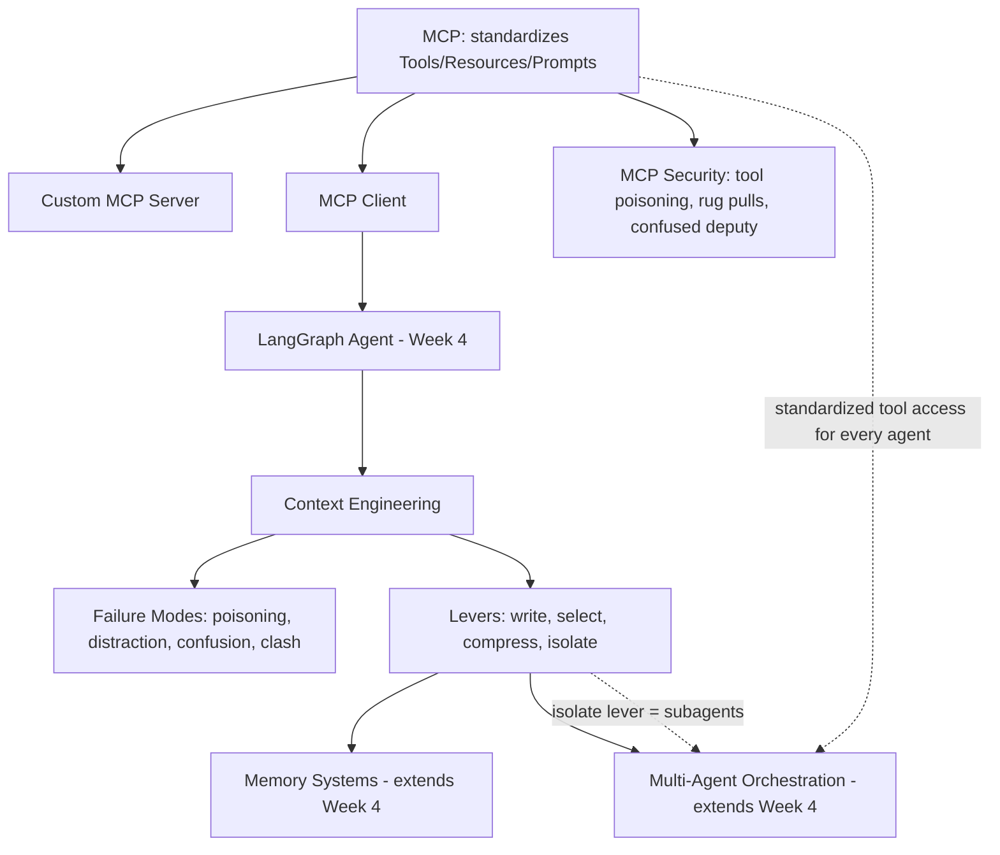
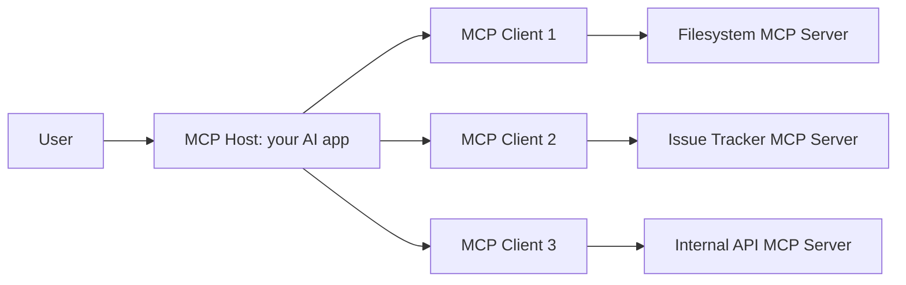
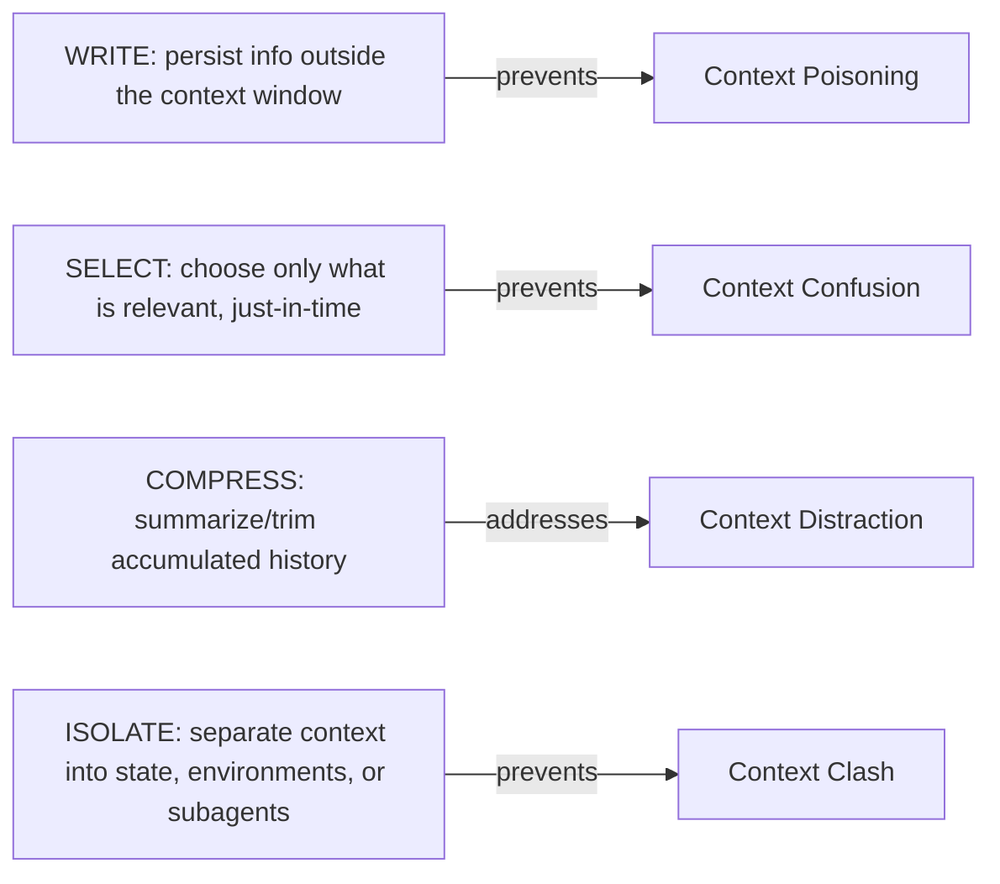
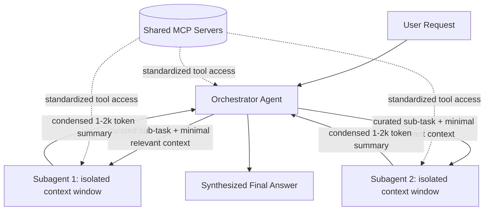
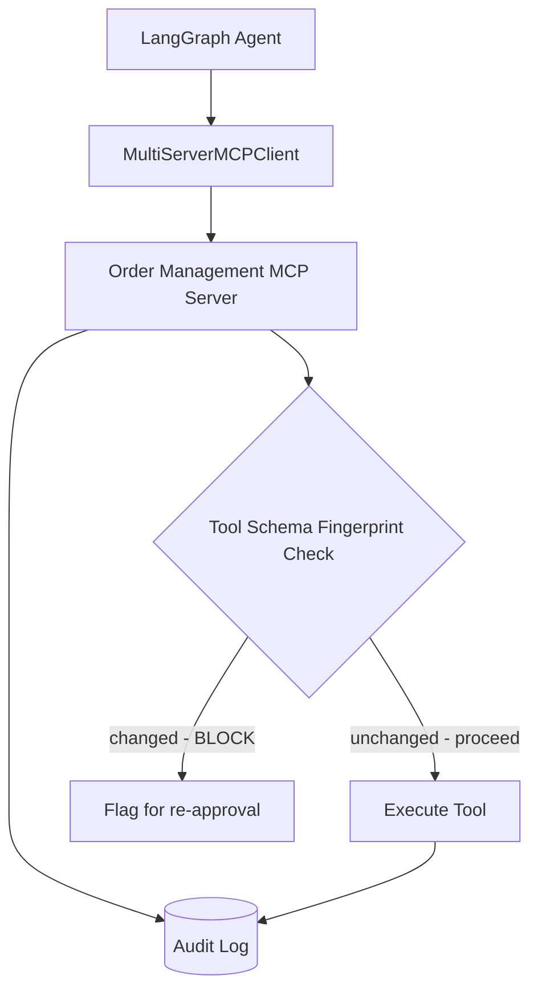

# Week 6 — MCP, Context Engineering & Multi-Agent Orchestration

## Week Objective

By the end of this week, you should be able to: explain MCP's architecture precisely enough to debug a broken client-server connection; build both a custom MCP server (exposing tools, resources, and prompts) and a client that consumes one (both raw and via LangChain/LangGraph); name and defend against MCP's documented attack classes (tool poisoning, rug pulls, tool shadowing, confused deputy); apply context engineering's four-lever framework (write/select/compress/isolate) to diagnose and fix a degrading agent; and design multi-agent systems where context isolation and standardized tool access (via MCP) are treated as first-class architectural decisions, not afterthoughts.

## Learning Map



The throughline: MCP standardizes **what** context/capabilities an agent can access; context engineering governs **how much of it, and in what form**, actually enters the model's context window at each step; memory and multi-agent architecture are both, at their core, **applications of context engineering's "isolate" and "write" levers** at a larger scale.

---

# 1. Why These Topics Belong Together

## What Problem Does This Week Solve?

Week 4 gave every agent its own bespoke tool integrations (hand-written Python functions). That doesn't scale past one team or one agent: every new agent that needs order lookups re-implements or re-imports the same integration, with no standard way to audit, version, or secure it consistently across a growing fleet of agents. Meanwhile, as agents' toolsets and conversation histories grow (exactly what Week 4's single-vs-multi-agent discussion anticipated), a new problem appears that has nothing to do with *which* tools exist and everything to do with *how much* of everything gets crammed into context at once — this is context engineering's territory, and it's what makes multi-agent architecture (Week 4, section 12) about more than just "specialization for prompt clarity."

## Mental Model

MCP is the **standardized wiring** connecting agents to the outside world — the electrical socket every appliance (agent) can plug into, instead of every appliance needing its own custom wiring. Context engineering is **deciding what actually gets plugged in and switched on at any given moment**, since the outlet having power available doesn't mean every appliance should run simultaneously. Multi-agent orchestration and memory are both, fundamentally, **applications of that same context-budget discipline** at the scale of an entire system rather than one conversation.

---

# 2. MCP Architecture

## What Is It?

The Model Context Protocol (MCP) is an open, standardized client-server protocol — donated by Anthropic to the Linux Foundation's Agentic AI Foundation in December 2025 — that defines exactly how an AI application discovers and invokes external tools, reads external data, and uses predefined prompt templates, through one consistent interface, regardless of which specific tool or data source is behind it.

## Why Does It Exist? / What Problem Does It Solve?

Before a standard existed, every AI application that wanted to integrate with, say, GitHub, Slack, and a filesystem had to write three separate, bespoke integrations — and every *other* AI application wanting the same three integrations had to write its own three, again. This is the exact "M×N integration problem" that USB, ODBC, and LSP (the Language Server Protocol, which MCP is explicitly modeled after) each solved in their own domains: define one protocol, and any client can talk to any server that implements it, turning M×N bespoke integrations into M+N standardized ones.

## Mental Model

MCP's three participants map directly onto a familiar client-server shape:

| Participant | Role | Analogy |
|---|---|---|
| **Host** | The AI application coordinating everything (e.g., Claude Desktop, Claude Code, your own LangGraph app) | The computer |
| **Client** | A component *inside* the host holding exactly one dedicated connection to exactly one server | One USB cable |
| **Server** | A program exposing tools, resources, and prompts through the protocol | One USB peripheral |

A host creates **one client per server** — an application connected to a filesystem server, an issue tracker, and an internal API server is running three separate MCP client connections simultaneously, each independently negotiated.



## How It Works — Two Layers

### Data Layer
A **JSON-RPC 2.0** based exchange protocol defining capability/version discovery and the core primitives (below). Every message — request, response, or notification — is a JSON-RPC message, regardless of which transport carries it.

### Transport Layer
Two supported mechanisms, each suited to a different deployment shape:

| Transport | How It Works | When Used |
|---|---|---|
| **stdio** | Standard input/output streams between processes on the same machine | Local integrations — no network overhead, best raw performance. This is how Claude Desktop launches a local filesystem server, for example. |
| **Streamable HTTP** | HTTP POST for client→server messages, with optional Server-Sent Events for server→client streaming | Remote servers — a server running as its own hosted service (e.g., a company's internal API exposed as an MCP server other teams' agents connect to over the network) |

**Important, current detail**: Streamable HTTP *replaced* an older "HTTP+SSE" transport from the 2024-11-05 spec revision. If you see MCP server code establishing a long-lived SSE connection as its *primary* transport, that's the older pattern — current servers should default to Streamable HTTP, falling back to the legacy transport only for backward compatibility with older clients.

## The Three Server Primitives

| Primitive | What It Is | Who Decides When to Use It | Example |
|---|---|---|---|
| **Tools** | Callable functions/actions the model can invoke — the direct MCP-standardized equivalent of Week 4's tool-calling mechanism | The **model** decides, the same way it decides to call any Week 4 tool | `create_support_ticket(summary, priority)` |
| **Resources** | Structured data or context (files, database records, documents) accessible by URI, for the client/model to *read* | The **application/client** typically decides what to attach, though a host may also let the model request one | `file:///docs/refund-policy.md` |
| **Prompts** | Predefined, reusable prompt templates the client can fetch, fill with arguments, and use to drive a structured interaction | The **user or client application** typically selects a prompt template explicitly | A "summarize-this-ticket" template exposed by a support-desk server |

**The distinction between Tools and Resources is the one to keep straight**: Tools *do* things (and can have side effects, exactly like Week 4's `issue_refund`); Resources *provide* things (read-only context, exactly like a Week 2 retrieved chunk, but addressed by URI instead of by similarity search).

## Client Features (Server-Initiated Requests)

MCP isn't purely one-directional — servers can request things *from* the client/host:

| Feature | Purpose | Current Status |
|---|---|---|
| **Roots** | The client tells the server which directories/URIs it's allowed to operate within — a scoping mechanism | Active |
| **Elicitation** | The server asks the client to collect additional input from the user mid-operation (e.g., "confirm deletion of 3 files?") | Active — evolving; the newest spec revision candidate reworks this into a stateless request/response shape rather than holding a connection open, so any server-side confirmation flow can be retried by a different server instance |
| **Sampling** | The server asks the client's LLM to generate a completion on the server's behalf | **Deprecated as of the 2026-07-28 spec revision** — if you see a tutorial relying on sampling as a core pattern, treat it as legacy |

## Current Spec State (Be Precise About This — MCP Moves Fast)

- **2025-11-25** is the current stable, widely-implemented specification revision as of this writing — everything above describes this version.
- **2026-07-28** is a *release candidate* for the next revision, introducing a stateless protocol core (removing the traditional `initialize` handshake in favor of every request carrying its own version/capabilities), an Extensions framework, "Tasks," and the sampling deprecation noted above. Treat this as *emerging direction*, not yet the deployed baseline — verify at https://modelcontextprotocol.io before building against release-candidate specifics.
- MCP is governed through Working Groups and a formal Spec Enhancement Proposal (SEP) process under the Linux Foundation's Agentic AI Foundation, not unilaterally by Anthropic — a direct consequence of the December 2025 donation.

## Common Mistakes
- Building against SSE-as-primary-transport patterns from outdated tutorials — Streamable HTTP is current for remote servers.
- Treating Tools and Resources as interchangeable — a database lookup with no side effects the model should *choose* to invoke is usually still a Tool if the model needs to supply parameters and decide *when* to call it; a resource is for content the client attaches as available context, addressed by URI.
- Assuming "sampling" is a core building block to design around, based on older material — it's deprecated in the newest spec direction.

## Interview Questions
- Q: Why does an MCP host create one client per server rather than one client shared across all servers?
  A: Each client holds a dedicated, independently-negotiated connection (transport, capabilities, session state) to exactly one server — this isolation is what lets a host connect to many heterogeneous servers cleanly, the same reason you don't share one USB cable across multiple peripherals.
- Q: What specific problem does MCP solve that bespoke, one-off API integrations don't?
  A: It turns an M×N integration problem (M applications × N tools, each needing a custom integration) into an M+N one — any MCP-compliant client can talk to any MCP-compliant server without a new bespoke integration, the same value LSP provides for editors and language tooling.

## 🧠 Memory Anchor
Host runs Clients, one per Server. Data layer = JSON-RPC 2.0; Transport = stdio (local) or Streamable HTTP (remote). Three primitives: Tools act, Resources provide, Prompts template.

---

# 3. Building Custom MCP Servers

## What Is It?

Writing a program that exposes your own tools, resources, and/or prompts through the MCP protocol, so any MCP-compliant client (your own agent, or someone else's) can discover and use them without a bespoke integration.

## How It Works — FastMCP, the De Facto Python Framework

`FastMCP` (bundled with the official Python MCP SDK) provides decorator-based registration, generating the JSON-RPC-level protocol handling, capability negotiation, and JSON schema generation for you — the same "decorators generate the schema" ergonomics as Week 4's `@tool` from `langchain_core.tools`, just at the protocol level instead of the LangChain level.

```python
from mcp.server.fastmcp import FastMCP

mcp = FastMCP("Order Management")

@mcp.tool()
def get_order_status(order_id: str) -> str:
    """Look up the status of a customer order by its ID."""
    # ... real lookup logic ...
    return f"Order {order_id}: delivered"

@mcp.resource("policy://refund")
def refund_policy() -> str:
    """The company's current refund policy document."""
    return "Refunds are issued within 30 days of purchase..."

@mcp.prompt()
def draft_refund_response(order_id: str) -> str:
    """Template for drafting a refund confirmation message."""
    return f"Draft a polite refund confirmation for order {order_id}."

if __name__ == "__main__":
    mcp.run(transport="stdio")   # or transport="streamable-http" for a remote server
```

Three things worth noticing directly from this example:
1. The **docstring becomes the tool/resource/prompt's description** — exactly the same "this is what the model uses to decide when to call it" principle from Week 4's tool-calling section, now standardized at the protocol level.
2. **Type hints generate the JSON schema** automatically — no separate, hand-maintained schema to keep in sync with the function signature.
3. **`transport` is a one-line switch** between local (stdio) and remote (Streamable HTTP) deployment — the same server code serves both shapes.

## Internal Mechanism — What Actually Happens at Startup

1. The client (or host) launches the server process (stdio) or connects to its URL (Streamable HTTP).
2. Capability negotiation: client and server exchange their supported protocol version and capabilities.
3. The client calls `list_tools`/`list_resources`/`list_prompts` to discover what's available.
4. The model (via the host) sees the tool schemas exactly as it would see any Week 4 tool definition — MCP's job ends at "get the model a well-formed schema and a way to invoke it"; everything about *how* the model decides to call it is identical to Week 4's tool-calling mechanism.

## Important Trade-offs
- A single, focused MCP server (e.g., "Order Management" only) is easier to secure, audit, and reason about than one giant server exposing dozens of unrelated tools — mirrors Week 4's "too many tools degrades selection accuracy" guidance, now at the server-design level.
- stdio servers are simpler to develop and debug locally but can only be used by a host running on the *same machine*; Streamable HTTP servers can be shared across an organization but take on real network security responsibilities (see section 5).

## Common Mistakes
- Writing a vague docstring on an MCP tool, exactly the Week 4 tool-description mistake, just now affecting every client that ever connects to this server, not just one agent's local tool definition.
- Exposing write/side-effecting operations (refunds, deletions) as Tools without also thinking about section 5's security model — MCP makes it *easy* to expose a powerful action; it does nothing to stop you from exposing one carelessly.

## 🧠 Memory Anchor
FastMCP's `@mcp.tool()`/`@mcp.resource()`/`@mcp.prompt()` decorators are the server-side mirror of Week 4's `@tool` — docstrings and type hints become the protocol-level schema automatically.

---

# 4. Building MCP Clients

## What Is It?

The code that connects to one or more MCP servers, performs the capability handshake, discovers available tools/resources/prompts, and makes them usable by an agent — in your case, a LangGraph agent exactly like Week 4's Persistent Operator.

## How It Works — Raw MCP SDK

```python
from mcp import ClientSession, StdioServerParameters
from mcp.client.stdio import stdio_client

server_params = StdioServerParameters(command="python", args=["/path/to/order_server.py"])

async with stdio_client(server_params) as (read, write):
    async with ClientSession(read, write) as session:
        await session.initialize()          # the capability handshake
        tools = await session.list_tools()  # discovery
        result = await session.call_tool("get_order_status", {"order_id": "ORD-1001"})
```

For a remote, Streamable HTTP server, the shape is nearly identical, swapping the transport:
```python
from mcp.client.streamable_http import streamablehttp_client

async with streamablehttp_client("http://localhost:3000/mcp") as (read, write, _):
    async with ClientSession(read, write) as session:
        await session.initialize()
        ...
```

## How It Works — LangChain/LangGraph Integration

Writing raw `ClientSession` code for every server your agent needs is exactly the kind of repetitive plumbing a dedicated adapter should handle — `langchain-mcp-adapters` (or the newer, official `langchain.mcp` module in `langchain>=1.4.0`) converts MCP tools directly into LangChain-compatible tools, so they drop straight into `bind_tools()` (Week 4) or `create_agent()` alongside any hand-written tools.

```python
from langchain_mcp_adapters.client import MultiServerMCPClient

client = MultiServerMCPClient({
    "orders": {
        "command": "python",
        "args": ["/path/to/order_server.py"],
        "transport": "stdio",
    },
    "policies": {
        "url": "http://localhost:8000/mcp",
        "transport": "http",
    },
})

tools = await client.get_tools()   # MCP tools from BOTH servers, as LangChain tools
# tools can now be passed directly into Week 4's llm.bind_tools(tools)
```

**Why `MultiServerMCPClient` matters architecturally**: this is the concrete mechanism by which "every agent in a multi-agent system uses the same standardized tool access" (this week's framing) actually gets implemented — instead of each agent hand-rolling its own order-lookup integration (Week 4's approach), every agent's tool list is populated from the *same* MCP servers, so a change to the order-lookup implementation happens once, on the server, and is instantly reflected everywhere it's used.

## Practical Example — Newer, Official LangChain MCP Module
LangChain's more recent, officially-supported path (beta, in `langchain>=1.4.0`) wraps the same underlying FastMCP client machinery in a slightly higher-level `MCPAdapter`:
```python
from langchain.agents import create_agent
from langchain.mcp import MCPAdapter

async with MCPAdapter("https://example.com/mcp") as adapter:
    tools = await adapter.list_tools()
    agent = create_agent("claude-sonnet-5", tools)
```

## Important Trade-offs
- `langchain-mcp-adapters` (the original, widely-adopted community-turned-LangChain-maintained package) and the newer `langchain.mcp` module both exist simultaneously at the time of writing — check which your LangChain version actually ships before assuming either is the current default; this is a genuinely fast-moving piece of the stack.
- Aggregating tools from many MCP servers into one agent (via `MultiServerMCPClient`) reintroduces Week 4's "too many tools degrades selection accuracy" risk at a new scale — MCP makes it *easy* to add a tenth server's tools to an agent's toolset; whether the agent can still reliably choose among all of them is a separate, real concern (section 6 addresses this directly).

## Common Mistakes
- Not calling `session.initialize()` before attempting discovery/tool calls — the capability handshake is a required first step, not optional setup.
- Blindly aggregating every available tool from every connected server into one agent without applying section 6's context-engineering discipline to *curate* the loadout per task.

## 🧠 Memory Anchor
`MultiServerMCPClient` is what turns "standardized tools" from a protocol-level abstraction into an actual list of LangChain tools your Week 4 agent can `bind_tools()` — one config dict, many servers, one unified tool list.

---

# 5. MCP Security

## What Is It?

The set of attack classes specific to MCP's architecture — where the LLM sees and trusts tool descriptions and tool *results* as part of its context — plus the concrete defenses that mitigate them. This is distinct from (and a precursor to) Week 8's broader AI reliability/safety curriculum: this section is specifically about the risks introduced by *standardizing* tool access through MCP.

## Why Does It Exist? / What Problem Does It Solve?

MCP's core value — the model sees a uniform set of tool descriptions and can freely call any of them — is exactly what creates its attack surface: **the LLM will trust anything that sends it convincing-sounding tokens**, whether that's a tool's stated description or the *content returned by a tool call*. Standardizing tool access at scale means a security failure in one server can now affect every agent connected to it, rather than being contained to one bespoke integration.

## The Core Attack Classes

### Tool Poisoning
Malicious instructions embedded directly in a tool's description, parameter schema, or return values — designed to manipulate the model's behavior. Because **the LLM sees all tool descriptions from every connected server in its context simultaneously**, a single malicious server can inject instructions that influence how the model behaves toward *other*, legitimate tools too.

### Rug Pull (Silent Redefinition)
A tool's definition changes *after* a user or system has already approved it. You review and approve a safe-looking tool on day one; by day seven, its description (or behavior) has silently changed to route sensitive data to an attacker. This works because most MCP clients show the tool description once, at approval time, and don't reliably notify users when that description subsequently changes — a documented, named gap (Elastic Security Labs and others report most clients don't re-prompt on description changes). Remote servers can flip their `tools/list` response at will, at any time, with no user action required at all; local (package-installed) servers require a version update the user has to install, giving a narrower re-review window that in practice few people actually use.

### Tool Shadowing / Cross-Server Attacks
When multiple MCP servers are connected to the same agent, a malicious server can override or intercept calls intended for a trusted one, because the model's tool-selection reasoning operates over the combined pool of all tools from all servers without an inherent trust boundary between them.

### Confused Deputy Attacks
A system with legitimate, elevated privileges is manipulated into using those privileges on behalf of someone (or something) that shouldn't have them. Concretely: an agent has approved, legitimate access to a `snowflake_query` tool for its actual job (generating weekly reports). A document the agent processes contains injected text instructing it to run a *different* query — one that pulls customer PII into the report. The agent never did anything it wasn't authorized to do — it has the grant to call `snowflake_query` — but the specific query it ran wasn't the one its deployer intended. A root cause worth naming explicitly: **MCP does not inherently carry end-user identity from the host application through to the server** — from the server's point of view, it often cannot distinguish which human, with what authority, actually initiated a given tool call, which is precisely what makes confused-deputy scenarios possible.

### Indirect Prompt Injection via Tool Results
Distinct from injection via user input: the injected instructions arrive embedded in *content a tool call returns* (e.g., text buried inside a wiki page an agent retrieved via a `search` tool), which then becomes part of the model's context exactly like any other tool result — a vulnerable agent may follow instructions found there as if they came from its actual operator. This doesn't require compromising any infrastructure; it only requires getting malicious content into a resource the agent will eventually read.

## Concrete, Documented Mitigations

| Mitigation | Addresses |
|---|---|
| **Treat all tool descriptions AND tool outputs as untrusted input** — never assume either is safe just because it came through a "trusted" server | Tool poisoning, indirect prompt injection |
| **Show the full tool schema at approval time, and re-prompt on ANY description change** (not a friendly summary) | Rug pulls |
| **Isolate sensitive servers from general-purpose ones** so a poisoned general-purpose tool can't reach a high-privilege server without a separate, explicit boundary | Tool shadowing, cross-server cascades |
| **OAuth 2.1 with PKCE, tokens bound to a specific audience** for remote (Streamable HTTP) servers — MCP servers are now commonly treated as OAuth 2.0 resource servers | Confused deputy over network transports, token theft |
| **Validate that a session/token belongs to the current requester on every request** | Confused deputy |
| **Static/pre-deployment scanning of tool descriptions and schemas** (tools like MCP-Scan exist specifically for this) integrated into CI/CD | Tool poisoning, rug pulls, unsafe cross-origin configuration — a direct parallel to Week 5's CI/CD regression gate, now gating on *security* properties instead of quality metrics |
| **Sandbox local server execution; apply rate limits/quotas per session or tenant** | Command injection, path traversal, denial-of-service (documented as some of the most common real MCP vulnerability classes found in security audits) |

## Mental Model

An MCP server "carries the permissions of every tool it exposes" — meaning MCP security is fundamentally an **authorization problem**, not just a network-security one. Approving a server is closer to granting an employee a badge than installing a library: the badge's access needs to be scoped correctly on day one, *and* periodically re-verified, because what's behind the badge can change without you noticing.

## Common Mistakes
- Treating a one-time security review at server-approval time as sufficient — rug pulls specifically exploit the assumption that "approved once" means "safe forever."
- Connecting a general-purpose, broadly-scoped agent to both a low-trust server (e.g., "fetch and summarize any webpage") and a high-privilege server (e.g., "execute financial transactions") without any isolation between them — this is precisely the tool-shadowing/cross-server-cascade setup security researchers report cascades in the majority of tested multi-server compromises.
- Assuming MCP itself is inherently insecure, rather than understanding that these vulnerabilities exist "any time you provide tools to an LLM that can potentially be exposed to untrusted input" — MCP didn't invent this risk, it standardized (and therefore scaled) the surface area it applies to.

## When Should I Care Most?
Any time an agent (1) can take real, side-effecting actions (Week 4's `issue_refund`-style tools) AND (2) is exposed to any untrusted content (web results, documents, emails, other users' input) — the combination of "can act" and "reads untrusted content" is exactly the "lethal trifecta" security researchers warn about (the third leg being access to sensitive data worth exfiltrating).

## Interview Questions
- Q: What makes a "rug pull" attack specifically difficult to defend against with a one-time approval process?
  A: Most MCP clients show a tool's description once, at approval time, and don't reliably re-prompt the user when that description changes later — a server (especially a remote one) can silently redefine its tools' behavior at any point after initial approval with no further user action required.
- Q: In the confused-deputy scenario, why is it inaccurate to say the agent "did something it wasn't allowed to do"?
  A: The agent used a grant (calling `snowflake_query`) that it genuinely had — the attack didn't need to escalate its privileges, only to manipulate *which* specific action it took using privileges it was already legitimately entitled to use.

## 🧠 Memory Anchor
The LLM trusts tool descriptions AND tool results equally — both are attack surface. Approval is not a one-time event; a rug pull exploits exactly that assumption.

---

# 6. Context Engineering

## What Is It?

The discipline of deciding what information enters an agent's context window, in what form, at each step of its execution — treating the context window as a small, finite piece of working memory that a processor (the model) computes over, rather than assuming "just include everything, context is cheap."

## Why Does It Exist? / What Problem Does It Solve?

This is the direct, systematized extension of points that have been surfacing all program long: Week 1's attention-cost and "lost in the middle" discussion, Week 3's observation that too much irrelevant retrieved context hurts more than it helps, and Week 4's warning that a large, heterogeneous toolset degrades an agent's tool-selection accuracy. Context engineering gives these scattered observations one unifying vocabulary and a concrete, actionable framework, rather than leaving each as an isolated caveat.

## Mental Model

Treat the language model as a processor and the context window as its RAM: finite, and — critically — **filling it does not improve results by itself**. Everything else (files, databases, long-term memories, the full tool catalog, prior sessions) exists in storage until some part of your system deliberately loads it in. Good context engineering is finding the *minimal, high-signal* set of information for the current step and assembling it coherently — not maximizing how much is available.

## The Four Categories of Context

| Category | Examples |
|---|---|
| **Instructions** | System prompt, few-shot examples, behavioral rules |
| **Knowledge** | Retrieved documents (Weeks 2-3), facts, retrieved MCP Resources |
| **Tools** | The tool schemas currently bound to the model (Week 4) |
| **Memory/State** | Conversation history, long-term memory facts (Week 4), agent scratchpad |

## The Four Failure Modes (a widely-cited taxonomy across the field)

| Failure Mode | What Happens | Documented Evidence |
|---|---|---|
| **Context Poisoning** | A hallucination or error enters the context and is subsequently treated as reliable fact — and because agent context accumulates turn over turn, the error can compound rather than disappear | A single hallucinated fact embedded in a persistent "goals" section, referenced at every subsequent decision point, can derail dozens of turns of otherwise-correct reasoning before it's caught |
| **Context Distraction** | Accumulated history grows so large the model over-indexes on pattern-matching from that history instead of reasoning fresh about the current situation, effectively crowding out its trained knowledge | Google's Gemini 2.5 technical report notes a documented tendency, as context grows well beyond 100k tokens, toward repeating past actions from history rather than synthesizing novel plans |
| **Context Confusion** | Superfluous, irrelevant information in the context measurably degrades response quality, even when it doesn't literally contradict anything | The Berkeley Function-Calling Leaderboard found every tested model performs worse with more available tools, independent of context-length limits — a quantized Llama 3.1 8B given 46 tools failed completely on a task it succeeded at with 19 tools, despite both fitting comfortably in its context window. This is a direct, quantified confirmation of Week 4's "too many tools" warning. |
| **Context Clash** | Different parts of the accumulated context directly contradict each other (the user said X on turn 2, a retrieved document says otherwise on turn 5, a tool result on turn 8 invalidates an earlier decision) — the agent stalls or picks a source somewhat arbitrarily | Considered the most complex failure mode, since it requires reconciling genuinely conflicting information rather than simply filtering noise |

**A useful compression of the four**: poisoning and distraction are problems of *what stays* in context over time; confusion is a problem of *what enters* at all; clash is a problem of *what coexists* without being reconciled.

## The Four Levers (the corresponding mitigation framework, one per failure mode)



### Write
Persist important information *outside* the live context window (to files, a scratchpad, or structured state — Week 4's `AgentState` fields are literally this) rather than letting it live only in the accumulating message list, where a single bad entry is hard to correct and keeps getting re-read on every subsequent step. Anthropic's own internal evaluations found that a dedicated "memory tool" for externalizing information, combined with active context editing, delivered a documented 39% performance improvement in long-running agent evaluations, versus 29% from context editing alone — externalized, structured storage that avoids poisoning the live context is not a minor optimization.

### Select
Load only what's relevant to the *current* step, just-in-time, rather than eagerly attaching everything that *might* be relevant. This is the direct justification for MCP Resources being addressed by URI and fetched on demand, rather than every server dumping its entire dataset into context at connection time — and it's the direct fix for the Berkeley leaderboard's tool-count-degrades-accuracy finding: curate the *specific* tool loadout for the task at hand rather than binding every tool from every connected MCP server all the time.

### Compress
Summarize or trim accumulated history once it grows large, rather than letting it grow unbounded — Week 4's context-window-management discussion (sliding window, summarization on overflow) is a direct instance of this lever. Anthropic's reported figures: context editing alone reduced token consumption by 84% in a 100-turn web-search evaluation while *enabling* workflows that would otherwise fail outright due to context exhaustion — compression isn't just a cost optimization, it's sometimes the difference between a task completing at all or not.

### Isolate
Separate genuinely independent or conflicting streams of context into their own state, execution environment, or **separate subagent**, rather than merging everything into one shared context where it can clash. This is the direct bridge to section 8: Anthropic's multi-agent research system explicitly uses this lever, running subagents with isolated context windows that each return only a condensed (1,000-2,000 token) summary back to the orchestrator — a reported 90.2% improvement over single-agent performance on a complex research benchmark, with token usage alone explaining roughly 80% of the performance variance observed.

## Practical Example — Applying All Four Levers to One Agent
A research agent that's been running for 80 turns exhibits: (1) a hallucinated intermediate fact still being referenced (poisoning — fix: **write** it to inspectable state and correct it there, not just append a correction message that competes with the original in context), (2) increasingly repetitive tool calls as history grows (distraction — fix: **compress** older turns into a running summary), (3) degraded tool selection since 40 tools are bound the whole session even though only 5 are relevant to the current phase (confusion — fix: **select** a phase-appropriate tool subset dynamically), and (4) a contradiction between an early user constraint and a later retrieved document (clash — fix: **isolate** the retrieval step into its own subagent call that returns a resolved, single summary rather than raw, potentially-conflicting source text).

## Common Mistakes
- Treating "give the model more context" as a safe default action — per the mental model above, filling the window does not improve results by itself, and can actively degrade them (confusion, distraction).
- Applying only one lever (compression is the most commonly reached-for) while ignoring the others — each failure mode needs its *matching* lever; compressing history does nothing for context clash or tool-selection confusion.
- Not distinguishing context engineering from prompt engineering: prompt engineering optimizes the wording of a fixed prompt; context engineering decides what dynamically enters the prompt/context at all, at each step of a potentially long-running agent.

## Interview Questions
- Q: Why doesn't simply expanding the context window size solve context engineering problems?
  A: The four failure modes (poisoning, distraction, confusion, clash) are about the *quality and coherence* of what's in context, not raw capacity — the Berkeley leaderboard finding shows models performing worse with more tools even when everything still fits comfortably within the context window; more room to fill isn't the same as better-curated content.
- Q: Which lever directly motivates the multi-agent "isolate" architecture, and why?
  A: Isolate — running subagents with their own separate context windows prevents context clash (conflicting information merging into one shared context) and, per Anthropic's reported findings, having each subagent return only a condensed summary rather than its full raw context also substantially reduces token usage and improves overall performance.

## 🧠 Memory Anchor
Four failures — poisoning, distraction, confusion, clash. Four levers — write, select, compress, isolate. One-to-one mapping. "More context" is never automatically the fix.

---

# 7. Memory in Agents (Extending Week 4)

## What Is It?

Everything Week 4 established (short-term/session memory via a checkpointer, long-term/cross-thread memory via a store) is, viewed through this week's lens, a specific application of context engineering's **write** lever: memory exists specifically to move information *out* of the ever-growing live context and into durable, addressable storage that can be selectively reloaded later.

## Why This Framing Matters

Week 4 asked "how does an agent remember things across conversations?" This week asks the sharper, complementary question: "given that memory storage is basically unbounded but the context window is not, what governs *what gets written*, and *what gets selected back in*, at any given moment?" This is exactly sections 6's write/select levers, applied specifically to the memory subsystem rather than to general conversation history.

## How It Works — Memory as Structured, Externalized State

Anthropic's internal "memory tool" pattern (referenced in section 6) generalizes Week 4's `remember_customer_fact` tool: rather than an ad hoc single tool, a fuller memory system typically exposes structured operations — write a note, read notes matching a query, update/delete a stale note — treated as first-class, auditable operations rather than an implicit side effect of conversation. Combining this kind of explicit memory tool with active context editing (the **compress** lever) is what produced Anthropic's reported 39% performance improvement figure cited in section 6 — write and compress working together, not either alone.

## Memory in Multi-Agent Systems — Shared vs. Isolated

This is the genuinely new question this week adds to Week 4's memory discussion:

| Pattern | How It Works | Trade-off |
|---|---|---|
| **Shared memory store** | Every agent in a multi-agent system reads/writes the same long-term memory store (e.g., the same `customer_id`-keyed store from Week 4) | Consistency — every agent sees the same facts — but reintroduces context-clash risk if two agents write conflicting facts, or context-confusion risk if one agent's memory writes are irrelevant noise for another agent's task |
| **Isolated per-agent memory** | Each specialized agent maintains its own memory scope | Avoids cross-agent noise/clash, but can produce genuine inconsistency (agent A learned something agent B never sees) unless deliberately synchronized |
| **Orchestrator-mediated memory** | Subagents don't access long-term memory directly; the orchestrator reads/writes memory and passes only the relevant, curated subset down to each subagent for its specific sub-task | Combines the **select** and **isolate** levers directly — this is the pattern Anthropic's multi-agent research system uses, and is generally the most context-engineering-disciplined of the three |

## Common Mistakes
- Giving every subagent in a multi-agent system unrestricted read/write access to one shared memory store "for simplicity" — this is exactly the setup that produces context clash (section 6) between agents' memory writes, and reintroduces the tool-shadowing-style "no isolation boundary" problem from section 5, now applied to memory instead of tools.
- Treating memory writes as unaudited, implicit side effects rather than explicit, logged operations — memory silently accumulating incorrect or stale facts is context poisoning (section 6) with a *very* long blast radius, since a bad long-term memory entry can resurface and mislead every future conversation with that customer.

## 🧠 Memory Anchor
Memory is the **write** lever, formalized and made durable. In multi-agent systems, prefer orchestrator-mediated memory access (select + isolate combined) over every subagent freely reading/writing one shared store.

---

# 8. Multi-Agent Orchestration Patterns (Extending Week 4)

## What Is It?

Week 4, section 12 introduced multi-agent architectures (supervisor/worker, hierarchical, pipeline, peer-to-peer) as a way to address a single agent's *tool-selection and prompt-coherence* limits. This week reframes and extends that same set of patterns through a **context-isolation** lens: multi-agent architecture is, fundamentally, a way of giving different parts of a task their own separate context windows, so that context clash and confusion (section 6) can't leak across sub-task boundaries — plus, now, a way of giving different agents **standardized, shared tool access via MCP** (section 4) instead of duplicated, bespoke integrations per agent.

## Why This Reframing Matters

Week 4 justified multi-agent systems primarily by "specialization improves prompt/tool focus." This week adds a second, equally important justification backed by concrete evidence (section 6): **isolating context is itself a performance and reliability strategy**, independent of prompt specialization — Anthropic's reported 90.2% improvement figure and the finding that token usage alone explains ~80% of performance variance on a complex benchmark are about context isolation's effect specifically, not just about giving each subagent a nicer, narrower prompt.

## How It Works — The Orchestrator-Subagent Pattern, Now With MCP and Context Discipline



Two disciplines layered onto Week 4's supervisor/worker shape:
1. **Context isolation discipline**: each subagent gets its own context window, populated with only the curated subset of information relevant to its specific sub-task (the **select** lever) — not the orchestrator's entire accumulated history. It returns a condensed summary, not its full raw context, back up.
2. **Standardized tool access**: every agent (orchestrator and subagents alike) connects to the *same* MCP servers for common capabilities (Week 4's order lookups, refunds, etc.), rather than each agent implementing or importing its own bespoke version — a direct application of section 4's `MultiServerMCPClient` pattern across an entire multi-agent system, not just one agent.

## Agent-to-Agent Communication — A Complementary, Emerging Standard

Where MCP standardizes how *one agent* talks to *tools and data*, the **Agent-to-Agent (A2A) protocol** is an emerging, complementary standard specifically for how *one agent* discovers and communicates with *another independent agent* (potentially built by a different team or vendor entirely) — relevant context for multi-agent systems that span organizational boundaries, though this program's own multi-agent work (Week 4's patterns, this week's context-isolation refinement) is implemented within a single LangGraph process using subgraphs-as-nodes, not via a separate agent-to-agent network protocol. Worth knowing the term exists and roughly what problem it targets; treat it as a "watch this space" item rather than something to build against yet.

## Important Trade-offs (Extending Week 4's List)
| Trade-off | Detail |
|---|---|
| Context isolation benefit | Prevents context clash/confusion from leaking across sub-tasks; each subagent's smaller, focused context also directly improves its own tool-selection accuracy (section 6) | 
| Condensation cost | Subagents necessarily lose access to the orchestrator's full context — a genuinely relevant piece of information not included in the curated hand-off is simply unavailable to that subagent, a new, real failure mode this pattern introduces |
| Standardized MCP tool access | One implementation, consistently secured (section 5) and updated, used everywhere | A security or rug-pull compromise in one shared MCP server now has blast radius across *every* agent using it — Week 4's "multi-agent adds new failure modes" warning, now specifically about shared infrastructure risk |

## Common Mistakes
- Building a multi-agent system for prompt-specialization reasons alone (Week 4's original justification) while still passing each subagent the orchestrator's *entire* accumulated context "just in case" — this discards the actual context-isolation benefit that produces the large reported performance gains, while still paying multi-agent's coordination and cost overhead.
- Connecting every agent in a multi-agent system to its own separately-configured, duplicated tool integrations instead of shared MCP servers — reintroducing exactly the maintenance burden (section 1) MCP exists to eliminate.

## Interview Questions
- Q: Beyond prompt specialization, what is the second, evidence-backed justification for multi-agent architecture introduced this week?
  A: Context isolation itself — giving each subagent its own separate context window prevents context clash/confusion and, per Anthropic's reported findings, produces substantial performance gains largely explained by more disciplined, smaller token usage per subagent, independent of any prompt-wording improvements.
- Q: Why should multiple agents in one system connect to shared MCP servers rather than each maintaining its own tool integrations?
  A: It eliminates duplicated integration work and ensures a single point of update/security enforcement (section 5) — the trade-off is that a compromise or rug pull in that shared server now has a larger blast radius across every agent that depends on it.

## 🧠 Memory Anchor
Multi-agent = context isolation + standardized (MCP) tool access, not just "specialized prompts." Subagents return condensed summaries, not raw context, to the orchestrator.

---

## Key Connections Across the Whole Week

- **MCP (sections 2-4) standardizes the "Tools" and "Knowledge" categories of context (section 6)** — it's an infrastructure answer to *how* an agent gets access to something; context engineering is the discipline governing *how much of it* actually gets loaded into any given step.
- **MCP Security (section 5) and context engineering's "confusion"/"poisoning" failure modes (section 6) are two views of the same underlying risk**: the model treats whatever is in its context — a tool description, a tool result, a retrieved resource — as trustworthy by default. Section 5 names the adversarial version of this; section 6 names the accidental version.
- **Memory (section 7) is the "write" lever, formalized**; multi-agent orchestration (section 8) is the "isolate" lever, formalized — both sections 7 and 8 are best understood as *applications* of section 6's framework, not independent new topics.
- **The Berkeley Function-Calling Leaderboard finding (section 6) directly validates Week 4's "too many tools" caution with hard data** — and directly motivates why aggregating every MCP server's tools onto one agent (section 4) needs the "select" lever applied, not just because it's theoretically tidy.
- **Anthropic's multi-agent research findings tie sections 6 and 8 together concretely**: the reported 90.2% improvement and ~80% variance explained by token usage is direct evidence that context isolation, not merely task specialization, is what makes well-designed multi-agent systems outperform single agents.

## 🧠 Week Memory Anchors

- MCP: Host runs one Client per Server; JSON-RPC 2.0 data layer; stdio (local) or Streamable HTTP (remote) transport; Tools act, Resources provide, Prompts template.
- FastMCP's decorators mirror Week 4's `@tool` — docstrings and type hints become the protocol-level schema.
- The LLM trusts tool descriptions AND tool results equally — both are MCP's core attack surface (tool poisoning, rug pulls, confused deputy, indirect injection via results).
- A rug pull exploits the fact that approval is (wrongly) treated as a one-time event.
- Context engineering: four failure modes (poisoning, distraction, confusion, clash) map one-to-one onto four levers (write, select, compress, isolate). "More context" is never automatically the fix.
- Memory is the write lever made durable; prefer orchestrator-mediated memory access in multi-agent systems over shared free-for-all access.
- Multi-agent architecture's biggest evidence-backed justification this week is context isolation itself, not just prompt specialization — and every agent should reach shared capabilities through the same standardized MCP servers, not duplicated integrations.

## ⚡ 30-Second Revision (Whole Week)

MCP standardizes how agents access tools (act), resources (read), and prompts (template) through a Host/Client/Server architecture over JSON-RPC 2.0, carried by stdio (local) or Streamable HTTP (remote) — FastMCP builds servers with the same decorator ergonomics as Week 4's tools, and `MultiServerMCPClient` turns any number of connected servers into one unified LangChain tool list. Because the model trusts tool descriptions and tool results by default, MCP introduces a distinct, well-documented attack surface — tool poisoning, rug pulls (silent redefinition after approval), tool shadowing across servers, and confused-deputy attacks — mitigated by treating all tool descriptions/outputs as untrusted, re-approving on any change, isolating sensitive servers, and using OAuth 2.1 for remote auth. Context engineering treats the context window as finite working memory: four failure modes (poisoning, distraction, confusion, clash) each have a matching lever (write, select, compress, isolate) — "add more context" is never automatically correct, and hard evidence (the Berkeley leaderboard, Anthropic's internal evals) backs this. Memory (write, made durable) and multi-agent orchestration (isolate, applied at scale, now also using MCP for standardized shared tool access) are both best understood as concrete applications of this same four-lever framework, not separate new ideas.

## 🎯 Interview Cheat Sheet

| Question | Short Answer |
|---|---|
| What are MCP's three server primitives, and how do Tools and Resources differ? | Tools, Resources, Prompts. Tools are model-invoked actions (can have side effects); Resources are client-attached, read-only data addressed by URI. |
| Why is Streamable HTTP preferred over the older HTTP+SSE transport for remote MCP servers? | It replaced HTTP+SSE in the 2024-11-05→current spec evolution; current servers should default to it, keeping the legacy transport only for backward compatibility. |
| What is a "rug pull" attack in MCP, and why does it work? | A server silently changes a tool's definition after approval; it works because most clients show the description once at approval time and don't reliably re-prompt on later changes. |
| What is a confused deputy attack, concretely? | An agent uses a legitimately-granted tool (e.g., a database query tool) in a way its deployer didn't intend, because injected content manipulated *which* specific call it made — the agent never exceeded its actual permissions. |
| Name the four context engineering failure modes and their matching levers. | Poisoning→write, Confusion→select, Distraction→compress, Clash→isolate. |
| What hard evidence backs the "too many tools degrades performance" claim? | The Berkeley Function-Calling Leaderboard: every tested model performed worse with more tools, and a model with 46 tools failed completely on a task it succeeded at with only 19 — independent of whether both fit in the context window. |
| Why is multi-agent architecture justified by more than just "specialized prompts"? | Context isolation itself (separate context windows per subagent, condensed summaries returned) is independently evidence-backed to improve performance — Anthropic reported ~80% of performance variance explained by token usage/isolation discipline on a complex benchmark. |
| Why should multiple agents share MCP servers rather than each having its own tool integrations? | One implementation to build, secure, and update — Week 4's "too many tools" and Week 5-style maintenance concerns compound across agents if every agent duplicates its own integration instead. |

---

# Weekly Build — The Audited Tool Bridge

## What Are We Building?
A standardized, auditable AI tool integration layer: a custom MCP server exposing the Persistent Operator's tools (order lookup, refund, support ticket, calculator) with built-in audit logging and tool-description change detection (a concrete rug-pull defense), plus an MCP client integration replacing Week 4's direct, hand-wired tools with tools loaded dynamically via `MultiServerMCPClient` — with a context-engineering-aware tool loadout that curates which tools are bound per request rather than binding everything, always.

## Why Are We Building It?
This is the direct infrastructure this week's notes describe, applied to your own running system: it turns Week 4's bespoke, hand-wired tool functions into a properly standardized, independently auditable MCP server any future agent (including Week 8's multi-agent supervisor) can reuse without re-implementing anything, while directly demonstrating this week's security and context-engineering disciplines rather than only describing them.

## What We Will Learn Through the Project

| Week 6 Concept | Project Component |
|---|---|
| Custom MCP server (Tools, Resources) | An MCP server exposing the Persistent Operator's tools as MCP Tools, plus the refund policy as an MCP Resource |
| MCP client integration | Replacing Week 4's directly-bound tools with tools loaded via `MultiServerMCPClient` |
| MCP Security — rug-pull defense | A tool-description hash/fingerprint check that flags (and blocks) a tool whose schema has changed since it was last approved |
| MCP Security — audit logging | Every tool call executed through the server is logged with its full arguments and result, independent of the agent-level `tool_call_log` from Week 4 |
| Context engineering (select lever) | A curated, task-relevant tool loadout per request instead of always binding the full tool catalog |

## High-Level Architecture



## Main Components
1. **MCP server** (`FastMCP`) — exposes `get_order_status`, `issue_refund`, `create_support_ticket`, `calculate` as Tools, and the refund policy as a Resource, running over Streamable HTTP.
2. **Tool fingerprint registry** — stores an approved hash of each tool's name/description/schema; every discovery call compares the current schema's hash against the approved one and refuses to proceed on a mismatch until explicitly re-approved (the rug-pull defense from section 5).
3. **Audit log** — every tool invocation (arguments, result, timestamp) recorded server-side, independent of and complementary to the agent's own Week 4 `tool_call_log` — this is what makes the bridge "audited," not just "standardized."
4. **MCP client wiring** — `MultiServerMCPClient` replacing Week 4's direct `EXECUTABLE_TOOLS` dict, feeding discovered tools into the same LangGraph agent structure from Week 4.
5. **Context-aware tool loadout selector** — a lightweight router (reusing Week 3/4's routing pattern) that decides which subset of the full available tool catalog to actually bind for a given request, rather than always binding everything — the concrete "select" lever from section 6.

## End-to-End Flow
1. The MCP server starts, exposing its tools/resources over Streamable HTTP, each tool's schema fingerprinted and stored as "approved" on first run.
2. The agent process connects via `MultiServerMCPClient`, discovers available tools, and the fingerprint check runs — any tool whose schema doesn't match its approved fingerprint is excluded from the bound toolset and flagged, rather than silently trusted.
3. Per request, the loadout selector curates which of the remaining, approved tools are actually bound for this specific request.
4. The agent runs its Week 4 loop exactly as before, except every tool call is now routed through the MCP server rather than a local function call.
5. The MCP server logs every invocation to its audit log before returning the result.

## Implementation Milestones
1. Build the MCP server exposing the existing Persistent Operator tools via FastMCP; confirm `list_tools()` from a raw client shows correct schemas.
2. Add the tool fingerprint registry; confirm that manually editing a tool's docstring after first approval is correctly detected and blocks that tool from being bound.
3. Add server-side audit logging; confirm every tool call produces a corresponding audit entry independent of the agent's own trace (Week 5).
4. Replace Week 4's direct tool binding with `MultiServerMCPClient`-loaded tools in the LangGraph agent; confirm the agent's existing dependent-tool-call test scenario (Week 5's golden dataset) still passes unchanged.
5. Add the context-aware loadout selector; confirm binding a curated subset (rather than the full catalog) still lets the agent complete each golden scenario correctly.

## Definition of Done
- The agent successfully completes Week 5's `refund_requires_lookup_first` golden scenario using tools loaded entirely through MCP, not local function calls.
- Deliberately changing a tool's docstring after approval is detected by the fingerprint check and blocks that tool until re-approved — a demonstrated rug-pull defense, not just a described one.
- Every tool call made during a request has a corresponding server-side audit log entry, inspectable independently of the agent's own Week 4/5 tracing.
- The loadout selector demonstrably binds a different tool subset for at least two distinct request types.

## Failure Cases to Be Aware Of (not solved this week)
- OAuth 2.1 authentication for the Streamable HTTP server is not implemented this week — the server runs unauthenticated for local development, with a clear README note that this is required before any real remote deployment (see section 5).
- No cross-server isolation boundary is built yet (only one MCP server exists in this project) — the tool-shadowing defense (section 5) becomes relevant once a second, lower-trust server is introduced, a natural Week 8 extension.
- No A2A-style agent-to-agent communication — this project's multi-agent extension (if pursued) still runs as LangGraph subgraphs within one process, per section 8's noted scope for this program.

---

Say **BUILD WEEK 6** when you're ready to start implementation, milestone by milestone.